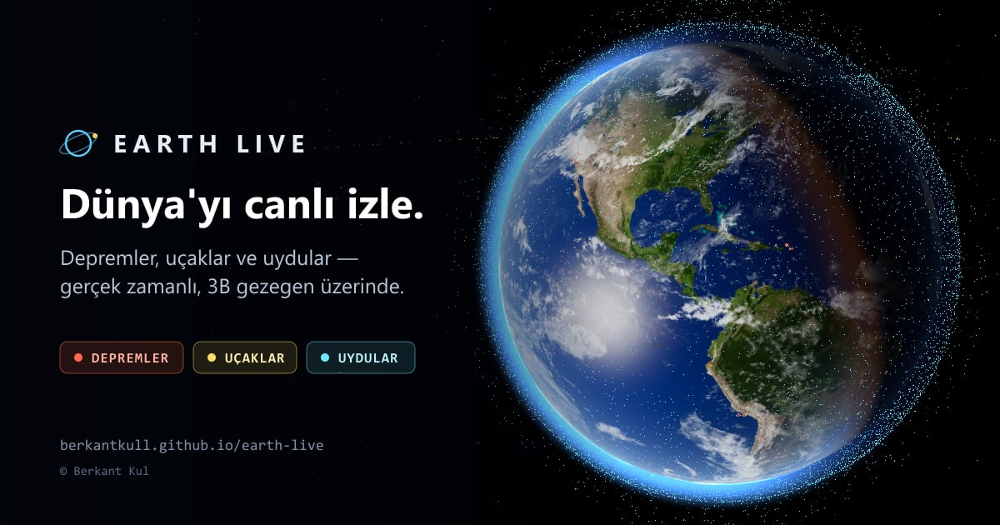

# EARTH LIVE — Global Observation & Monitoring System

Gerçek Dünya gözlem verilerini fotogerçekçi bir 3B gezegen üzerinde gösteren bilimsel izleme arayüzü.

**Canlı:** https://berkantkull.github.io/earth-live/

[](https://berkantkull.github.io/earth-live/)

- **Depremler** — USGS Earthquake Hazards Program GeoJSON akışları (son 1 saat → son 30 gün). Renk derinliği, boyut büyüklüğü gösterir; son 3 saatteki olaylar nabız halkasıyla işaretlenir. Detayda PAGER/tsunami bilgisi ve açığa çıkan enerji yer alır.
- **Uçaklar** — OpenSky Network ADS-B durum vektörleri (~12 bin uçak). Konumlar, ölçüm anından itibaren hız ve rota ile ileri tahmin edilir (dead reckoning); veri yenilemeleri arasında uçaklar akıcı hareket eder.
- **Uydular** — CelesTrak GP/TLE verisi; yörüngeler tarayıcıda, ayrı bir Web Worker içinde SGP4 ile hesaplanır. Seçilen uydu için bir periyotluk yörünge izi, canlı irtifa/hız/alt-uydu noktası ve yörünge elemanları gösterilir. CelesTrak bir grubu veremezse "tüm aktif uydular" için SatNOGS DB yedek kaynak olarak kullanılır.
- **Zaman çizelgesi** — Seçili deprem akışını (son 1 saat → son 30 gün) animasyonla oynatma; kaydırıcıyla herhangi bir ana gitme, hız seçimi, boşluk tuşuyla oynat/duraklat.
- **Aktif yangınlar** — NASA FIRMS, MODIS uydularının son 24 saatteki ~20 bin yangın tespiti; renk ve boyut ateş ışınım gücüne (FRP, MW) göre.
- **Doğal olaylar** — NASA EONET'teki açık volkan, şiddetli fırtına, buzdağı ve diğer olaylar; fırtınaların izi haritada çizilir.
- **Tektonik plakalar** — Bird (2003) PB2002 modelindeki 241 plaka sınırı; dalma-batma zonları ayrı renkte. Bir sınır seçilince uzunluğu ve seçili zaman aralığında sınıra 100 km içindeki depremler gösterilir.
- **Arama** — Şehir/yer (Open-Meteo Geocoding, GeoNames), uçuş (çağrı işareti, ör. `THY`) veya uydu (ad ya da NORAD numarası, ör. `ISS`, `25544`). Kamera seçilen yere ya da nesneye uçar.
- **Uydu geçiş tahmini** — Seçilen uydunun aranan şehir ya da cihaz konumu üzerinden önümüzdeki geçişleri: saat, en yüksek açı, doğuş/batış yönü ve çıplak gözle görünürlük (gökyüzü karanlık ve uydu Güneş ışığı alıyorsa).
- **Temiz açılış** — İlk ziyarette yalnızca Dünya görünür; kısa bir yönlendirme katman seçmeye davet eder. Seçimler hatırlanır; büyük veri setleri (uçak, uydu, yangın) katman açılana ya da aranana kadar indirilmez.
- **Önemli deprem uyarısı** — Son bir saatte M6+ ya da tsunami uyarılı bir deprem olursa üstte tek satırlık bildirim çıkar; "Göster" kamerayı depreme götürür. Her deprem için bir kez gösterilir.
- **Odak modu** — `F` tuşu ya da sağ üstteki düğmeyle tüm paneller gizlenir, yalnızca Dünya kalır; `F` / `Esc` ile çıkılır.
- **Türkçe / English** — Arayüz tarayıcı diline göre açılır; sağ üstteki TR/EN düğmesiyle değiştirilir ve tercih hatırlanır. Tarih, sayı ve yer araması sonuçları da seçili dilde gelir.
- **Uygulama olarak kurulum (PWA)** — Telefona ve bilgisayara uygulama gibi yüklenebilir; service worker sayesinde ikinci açılış önbellekten anında gelir, internet yokken son kaydedilen verilerle açılır.
- **Paylaşılabilir bağlantılar** — Kamera, seçili nesne ve filtreler adres çubuğunda tutulur (`#c=…&s=…`); bağlantıyı açan kişi aynı görünümü görür. Bağlantı paylaşıldığında önizleme kartı çıkar.
- **Gerçek aydınlatma** — Güneş-altı noktası astronomik formüllerle hesaplanır; gece/gündüz sınırı, şehir ışıkları, okyanus parlaması, bulut gölgeleri ve atmosfer gerçek zamana göre çizilir.
- **Veri kaynakları paneli** — her kaynağın durumu, son güncelleme, sonraki yenileme, öğe sayısı ve hata mesajları.

## İki çalışma modu

| | Sunucu modu (`npm run dev` / `npm start`) | Statik mod (GitHub Pages) |
| --- | --- | --- |
| Depremler, arama | Node sunucusu üzerinden, önbellekli | Tarayıcıdan doğrudan (CORS açık) |
| Uydular | Sunucu, disk önbelleği | `data` dalındaki anlık görüntü, yoksa doğrudan CelesTrak |
| Uçaklar | Sunucu, OpenSky | `data` dalındaki anlık görüntü (~5 dk'da bir) |
| Aktif yangınlar | Sunucu, NASA FIRMS | `data` dalındaki anlık görüntü (~30 dk'da bir) |
| Doğal olaylar | Sunucu, NASA EONET | Tarayıcıdan doğrudan (CORS açık) |

OpenSky tarayıcıdan doğrudan erişime izin vermediği için Pages sürümünde uçak ve uydu verisi
`.github/workflows/data.yml` iş akışıyla yaklaşık 5 dakikada bir toplanır ve `data` dalına tek commit olarak
yazılır (geçmiş birikmez). İş akışı her çalışmanın sonunda bir sonrakini kendisi başlatır; GitHub zamanlayıcısı
zincir koparsa yeniden başlatan bir yedektir. Arayüz bu dosyaları `raw.githubusercontent.com` üzerinden okur.

## Geliştirme

Gereksinim: Node.js ≥ 22.18 (sunucu TypeScript'i doğrudan çalıştırır).

```bash
npm install
npm run dev        # http://localhost:5173 — Vite + API aynı süreçte
npm test           # birim ve API testleri
npm run typecheck
```

Üretim (sunucu modu):

```bash
npm run build
npm start          # http://localhost:8787
```

## Yapılandırma

Yerelde `.env.example` dosyasını `.env` olarak kopyalayın. GitHub Pages sürümü için aynı OpenSky bilgilerini
depo ayarlarında **Settings → Secrets and variables → Actions** altına `OPENSKY_CLIENT_ID` ve
`OPENSKY_CLIENT_SECRET` olarak ekleyin.

| Değişken | Açıklama |
| --- | --- |
| `PORT` | Sunucu portu (varsayılan 8787) |
| `OPENSKY_CLIENT_ID`, `OPENSKY_CLIENT_SECRET` | OpenSky OAuth2 API istemcisi. Anonim erişim günde ~400 kredi ile sınırlıdır; hesapla 4000 krediye çıkar. |
| `AIRCRAFT_TTL` | Sunucu modunda uçak verisi önbellek süresi, saniye (varsayılan: kimlikli 60, anonim 300) |

## Mimari

```
server/            Node http sunucusu (çalışma zamanı bağımlılığı yok)
  api.ts           /api/earthquakes, /api/aircraft, /api/satellites, /api/geocode, /api/status, /api/health
  cache.ts         TTL önbellek: istek birleştirme, hata durumunda bayat veri, Retry-After'a uyan geri çekilme
  sources/         USGS, OpenSky (OAuth2), CelesTrak + SatNOGS (disk önbelleği), Open-Meteo
scripts/
  fetch-data.ts    Pages sürümü için veri anlık görüntüsü (GitHub Actions'ta çalışır)
src/
  data/            Sunucu ve statik mod veri katmanları
  globe/           Three.js sahnesi, Dünya/bulut/atmosfer shader'ları, kamera uçuşu
  layers/          Deprem, uçak ve uydu katmanları
  workers/         SGP4 hesabı için Web Worker
  lib/             Ayrıştırıcılar, koordinat dönüşümleri, güneş konumu, yörünge mekaniği, geçiş tahmini
  i18n.ts          Türkçe/İngilizce sözlükler (eksik çeviri derlemeyi durdurur)
  ui/              Detay, kaynak, lejant ve arama panelleri
tests/             Vitest: geometri, güneş/yörünge, ayrıştırıcılar, önbellek, API uç noktaları
```

## Veri ve doku kaynakları

- USGS deprem verisi — kamu malı (U.S. Government).
- OpenSky Network — [kullanım koşulları](https://opensky-network.org/about/terms-of-use), ticari olmayan kullanım.
- CelesTrak GP verisi — [celestrak.org](https://celestrak.org); SatNOGS DB — CC BY-SA 4.0.
- NASA FIRMS (MODIS C6.1 NRT) ve NASA EONET — NASA açık veri politikası; kaynak: NASA Earthdata / Earth Observatory.
- Tektonik plaka sınırları — Bird, P. (2003), *An updated digital model of plate boundaries*, G³ 4(3), 1027; GeoJSON: [fraxen/tectonicplates](https://github.com/fraxen/tectonicplates) (ODC-By 1.0).
- Open-Meteo Geocoding — CC BY 4.0, GeoNames verisi.
- Dünya dokuları — [Solar System Scope](https://www.solarsystemscope.com/textures/) (CC BY 4.0, NASA Blue Marble/Black Marble türevleri); normal ve speküler haritalar three.js örnek dokularından.

## Lisans

© 2026 Berkant Kul. Tüm hakları saklıdır. Ayrıntılar için [LICENSE](LICENSE).
